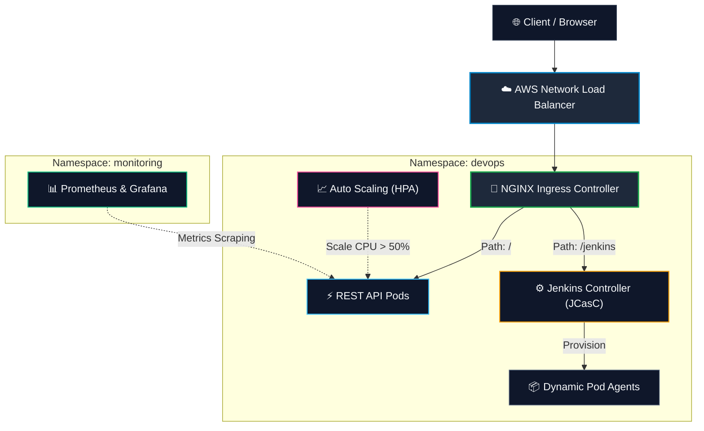
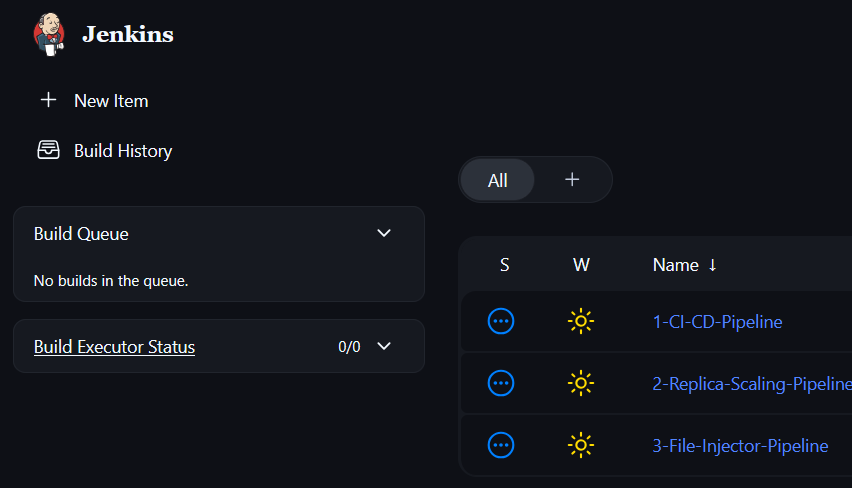
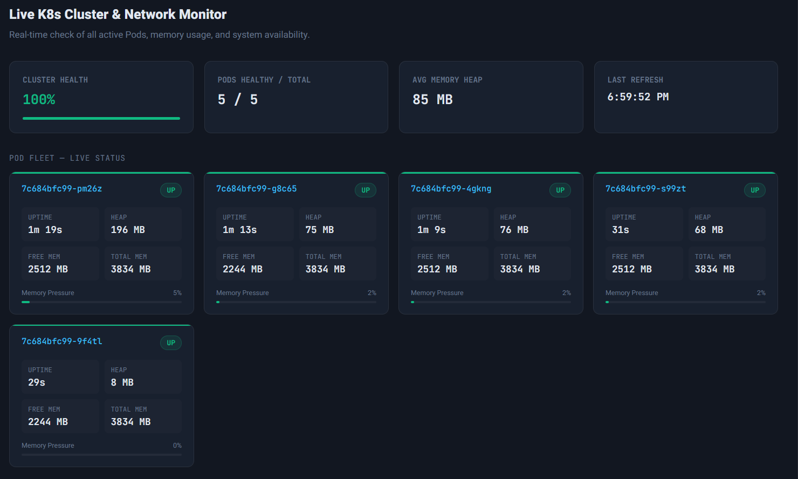
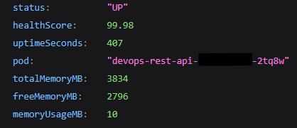
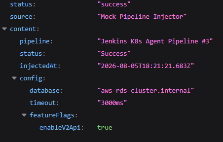

# Enterprise AWS EKS DevOps & CI/CD Platform

An enterprise-ready Cloud & DevOps infrastructure platform deployed on AWS EKS using Infrastructure as Code (Terraform), Kubernetes-native manifests, Jenkins Configuration as Code (JCasC), and full-stack observability with Prometheus and Grafana.

---

## 📐 Architecture Overview

The diagram below illustrates the end-to-end traffic flow, ingress routing, namespace isolation, and dynamic pod scaling inside the EKS cluster:



---

## 🛠 Tech Stack

| Domain | Technologies |
| :--- | :--- |
| **Cloud Provider** |   |
| **Infrastructure as Code** |  |
| **Containerization & Orchestration** |    |
| **Ingress & Networking** |  |
| **CI/CD Automation** |  |
| **Observability & Testing** |    |

---

## 📸 Live Environment & Proof of Concept

Real-time execution screenshots from the running EKS cluster demonstrate JCasC pipeline initialization, Pod auto-scaling, dynamic ConfigMap injection, and system health checks:

| Feature / Endpoint | Screenshot | Technical Description |
| :--- | :---: | :--- |
| **Jenkins JCasC & Job DSL** |  | Automatic non-interactive creation of all 3 pipelines upon Helm installation using JCasC and Job DSL. |
| **Live K8s Fleet Monitor** |  | Application UI showing 5 active Pods with memory and health metrics following dynamic replica scaling. |
| **Health Probe Endpoint** |  | Live `/health` response utilized by Kubernetes Liveness and Readiness probes. |
| **Dynamic File Injector** |  | Zero-downtime runtime ConfigMap injection executed live by Jenkins Pipeline #3. |

---

## 🌟 Business Value & Key Technical Features

This platform simulates an enterprise production environment designed for zero-downtime deployments, full pipeline automation, resilient self-healing, and operational security.

### 1. Fail-Fast Interactive Validation
* Before provisioning cloud resources in AWS, `up.sh` queries the **Docker Hub API** directly to validate credentials.
* If credentials or PATs are invalid or blank, the script halts before creating infrastructure, requesting valid inputs in a loop.

### 2. Containerized REST API
The application exposes essential operational endpoints:
* **`GET /`**: Base API status dashboard monitoring active cluster Pods.
* **`GET /health`**: Health check probe for Kubernetes Liveness and Readiness tests.
* **`GET /injected-file`**: Dynamic endpoint displaying runtime content injected via Kubernetes ConfigMaps and CI/CD pipelines.

### 3. Unified Ingress Routing (Zero Port Collision)
* **REST API Application**: Exposed securely at `https://<LOAD-BALANCER-IP>/`.
* **Jenkins Automation Dashboard**: Exposed securely at `https://<LOAD-BALANCER-IP>/jenkins`.
* **Fallback Port-Forwarding**: Local fallback configured on port `18080` to prevent collisions with standard local ports (e.g., 8080).

### 4. GitOps & Jenkins Configuration as Code (JCasC)
* **Zero Manual Setup**: Jenkins bootstraps non-interactively with pre-configured credentials, plugins, and security settings.
* **Job DSL Auto-Provisioning**: Detects the target GitHub repository dynamically and auto-generates 3 pipeline jobs on startup.

---

## 📋 Prerequisites & Pre-Deployment Preparation

Before running the deployment script, ensure your environment meets the following requirements:

### 1. System Tools
Ensure the following CLI utilities are installed and available in your system `PATH`:
* **AWS CLI** (`>= 2.x`) configured with active Administrator credentials (`aws configure`).
* **Terraform** (`>= 1.5.0`)
* **kubectl** (`>= 1.28`)
* **Helm** (`>= 3.12`)
* **curl**, **git**, and **openssl**

### 2. Docker Hub Account & Credentials
You need an active Docker Hub account to push and pull custom application images:
* **Docker Hub Username**: Your Docker Hub login handle.
* **Personal Access Token (PAT)**: Generated under **Docker Hub Account Settings -> Security -> New Access Token** (Permissions: Read, Write, Delete).

### 3. Git Repository Remote
Ensure your local repository has a valid remote URL set (`git remote -v`). If not configured, `up.sh` will prompt for your GitHub repository URL to allow Jenkins Job DSL to configure pipeline targets.

---

## ⚠️ Critical Operational Guidelines & Warnings

> [!WARNING]
> **Sequential Pipeline Execution Only**:
> Do **NOT** run multiple Jenkins pipelines concurrently. Running `1-CI-CD-Pipeline`, `2-Replica-Scaling-Pipeline`, or `3-File-Injector-Pipeline` at the same time will cause race conditions on the single Kubernetes `devops-rest-api` deployment rollout state and image tags. Always wait for a pipeline to finish (`SUCCESS`) before triggering another.

> [!NOTE]
> **SSL Self-Signed Certificate Warning**:
> The Ingress Controller uses a self-signed TLS certificate generated during deployment. When accessing `https://<LOAD-BALANCER-IP>/` or `/jenkins` for the first time, your browser will display a security warning. Click **Advanced -> Proceed to site** to continue.

> [!IMPORTANT]
> **AWS Provisioning Time & Cost**:
> Provisioning the complete EKS cluster, Node Groups, and VPC takes approximately **10 to 15 minutes**. To avoid unnecessary AWS charges, execute `./scripts/destroy.sh` as soon as testing is complete.

---

## 📂 Repository Structure

```text
.
├── docs/                     # Documentation & Proof of Concept Screenshots
│   └── images/               # Screenshots for README documentation
├── terraform/                # Infrastructure as Code (VPC, EKS Cluster, Subnets, IAM)
│   ├── main.tf
│   ├── eks.tf
│   ├── vpc.tf
│   ├── variables.tf
│   ├── outputs.tf
│   └── backend.tf
├── kubernetes/               # Kubernetes Manifests
│   ├── deployment.yaml       # REST API Deployment
│   ├── service.yaml          # ClusterIP Service
│   ├── ingress.yaml          # TLS Ingress routing (/ and /jenkins)
│   ├── hpa.yaml              # Horizontal Pod Autoscaler
│   ├── configmap.yaml        # Dynamic file injection target
│   ├── secret.yaml           # Registry secrets placeholder
│   └── namespace.yaml        # DevOps namespace definition
├── jenkins/                  # CI/CD Infrastructure as Code
│   ├── values.yaml           # Helm chart overrides with JCasC & Job DSL definitions
│   ├── Jenkinsfile.cicd      # Main CI/CD Pipeline (Build, Test, Push, Deploy)
│   ├── Jenkinsfile.replicas  # Dynamic Pod Scaling Pipeline
│   └── Jenkinsfile.injector  # Dynamic ConfigMap & File Injection Pipeline
├── scripts/                  # Operational Automation Scripts
│   ├── up.sh                 # End-to-End One-Command Deployment Script
│   ├── destroy.sh            # Complete Clean Teardown Script
│   └── k6-load-test.js       # k6 Performance & Load Testing Script
└── docker/                   # Node.js REST API Application Source Code
    ├── app.js
    ├── index.html
    ├── package.json
    └── Dockerfile
```

---

## 🚀 Quick Start: Single-Command Deployment

Execute the automated setup script from the root of the repository:

```bash
chmod +x scripts/up.sh scripts/destroy.sh
./scripts/up.sh
```

### What `up.sh` Automates:
1. **Pre-flight Check**: Interactively validates Docker Hub credentials against the Docker API.
2. **State Storage**: Creates S3 bucket and DynamoDB lock table for Terraform remote state.
3. **Infrastructure**: Runs `terraform apply` to create VPC, Subnets, EKS cluster, and Node Groups.
4. **Core Addons**: Deploys NGINX Ingress Controller, Metrics Server, and EBS CSI Driver.
5. **Security**: Generates TLS certificates and Kubernetes Docker registry secrets.
6. **Applications**: Deploys the REST API, Jenkins (via JCasC), and Prometheus/Grafana stack.

---

## 🧪 Verification & Pipeline Demonstration

Once the deployment script finishes and outputs the Load Balancer host, verify the platform using the following steps:

### 1. Accessing Application & Jenkins Endpoints
* **REST API Base URL**: `https://<LOAD-BALANCER-IP>/`
* **Health Check Probe**: `https://<LOAD-BALANCER-IP>/health`
* **Injected File Endpoint**: `https://<LOAD-BALANCER-IP>/injected-file`
* **Jenkins Automation Dashboard**: `https://<LOAD-BALANCER-IP>/jenkins`

### 2. Running Automated Jenkins Pipelines
Log into Jenkins (`https://<LOAD-BALANCER-IP>/jenkins`) using user `admin` and the password output by `up.sh`:

1. **`1-CI-CD-Pipeline`**:
   * Triggers a Docker-in-Docker (DinD) agent.
   * Builds the REST API image, tags it with `v${BUILD_NUMBER}`, pushes to Docker Hub, and performs an atomic Kubernetes rollout update.
2. **`2-Replica-Scaling-Pipeline`**:
   * Dynamically adjusts HPA `minReplicas` and scales the deployment (e.g., set `REPLICAS: 4`).
   * Verify using: `kubectl get pods -n devops`
3. **`3-File-Injector-Pipeline`**:
   * Injects dynamic JSON/text payload into the ConfigMap and triggers a rollout restart.
   * Verify changes live at `https://<LOAD-BALANCER-IP>/injected-file`.

### 3. Load Testing & Auto-Scaling (HPA)
Run the k6 performance test script to simulate high CPU usage on the API endpoints:

```bash
k6 run scripts/k6-load-test.js
```

Observe real-time Pod autoscaling in your terminal:

```bash
kubectl get hpa -n devops -w
```

---

## 🧹 Complete Teardown

To delete all AWS infrastructure, Helm releases, Load Balancers, and S3 state storage cleanly without leaving lingering costs:

```bash
./scripts/destroy.sh
```

---

## 👤 Author

* **LinkedIn**: [Ron Yehonatan](https://www.linkedin.com/in/ron-yehonatan-keinan/)
* **GitHub**: [Kinanw38](https://github.com/Kinanw38)